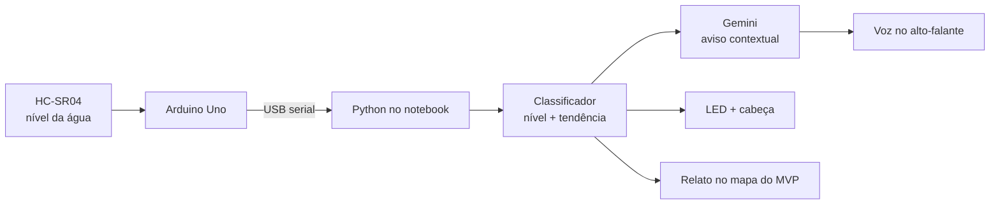
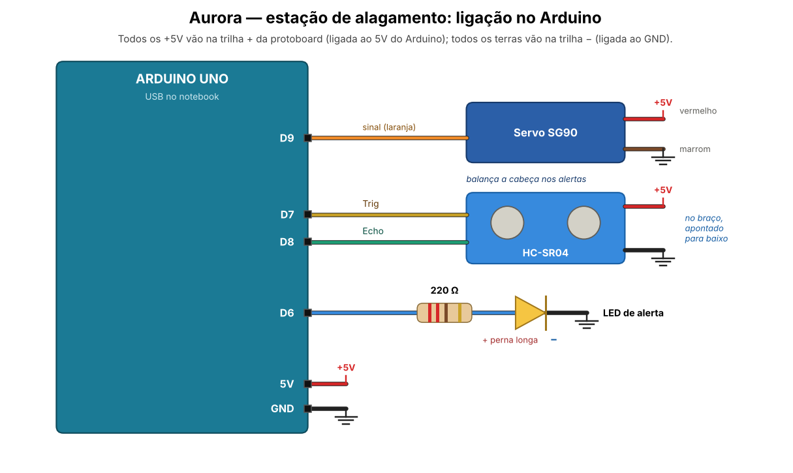
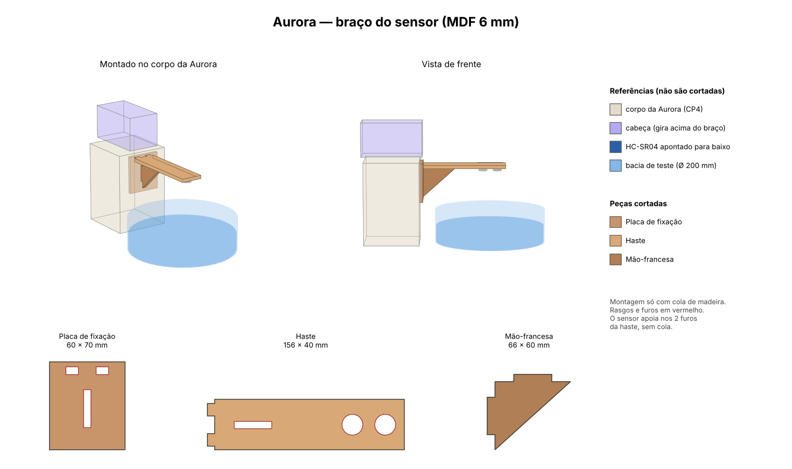
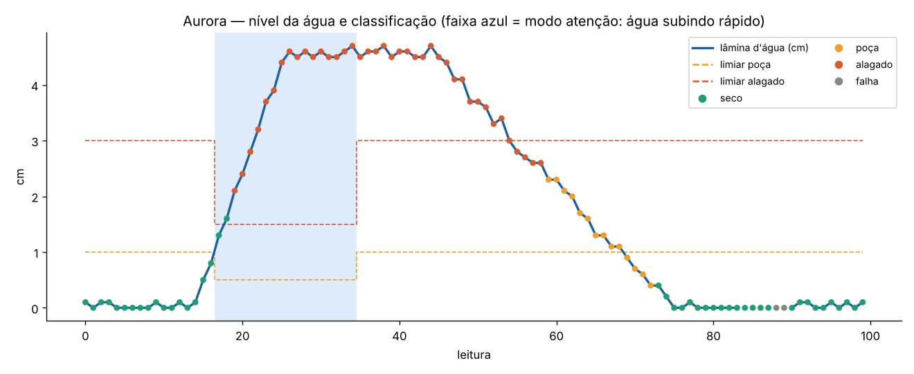

# 🌊 Aurora — Estação de Alagamento para Ciclovias

**Global Solution 2026.2 · CitizenTech · Project-Based Maker Lab**
Evolução do robô Aurora, desenvolvido no Checkpoint 4 da disciplina.

---

## 👥 Integrantes

> ⚠️ **Obrigatório:** sem o nome de todos os integrantes o grupo fica sem nota na GS.

| Nome | RM |
|------|----|
| Breno Silva | RM97864 |
| Enrico Marquez | RM99325 |
| Gustavo Dias | RM550820 |
| Joel Barros | RM550378 |
| Leonardo moreira | RM550988 |

## 🎬 Vídeo de demonstração

**[Assista no YouTube](COLE_O_LINK_AQUI)** (até 6 minutos)

---

## 1. O problema

Quando chove, alguns trechos de ciclovia alagam sempre nos mesmos lugares: passagens sob viadutos, baixadas e pontos com bueiro entupido. A água esconde buracos e degraus, e o ciclista só percebe quando já está dentro dela. O risco é de queda, de ferimento e de dano à bicicleta, justamente para quem usa a bicicleta como transporte do dia a dia.

Hoje ninguém avisa o ciclista **antes** de ele chegar ao ponto alagado.

## 2. A solução

A Aurora vira uma **estação fixa de monitoramento**, instalada em um ponto crítico da ciclovia. Ela:

1. **mede o nível da água** acumulada no piso, com um sensor ultrassônico apontado para o chão;
2. **percebe quando a água sobe rápido** e passa a alertar mais cedo;
3. **classifica o risco**: seco, poça ou alagado;
4. **avisa quem está chegando**: pisca o LED, balança a cabeça e fala um alerta criado por IA;
5. **registra o evento** e o envia para o mapa do MVP da equipe, para que o ciclista mude a rota antes de sair.

### Por que uma estação fixa, e não um robô que anda?

Fizemos as contas do tempo de reação. Um ciclista urbano anda a uns 18 km/h, ou 5 m/s, e precisa de cerca de 9 m para frear com o piso molhado (1 s de reação mais a frenagem). Um ultrassônico preso a um robô ou a uma bicicleta só enxerga de 0,5 a 1 m do piso à frente, então o aviso chegaria tarde demais.

Por isso o alerta precisa estar **no lugar do perigo e antes dele**:
- o LED, a cabeça em movimento e a voz chamam a atenção de quem se aproxima;
- o relato no mapa chega antes de o ciclista sair de casa.

## 3. Como funciona



O **Arduino** lê o sensor e comanda os atuadores. O **notebook** faz o processamento, a IA, a voz e a internet: o Uno não tem Wi-Fi e só tem 2 KB de RAM.

### Níveis de risco

| Nível | Lâmina d'água (normal) | Água subindo rápido | LED | Cabeça | Voz |
|-------|------------------------|---------------------|-----|--------|-----|
| **Seco** | menor que 1 cm | menor que 0,5 cm | piscada curta a cada 3 s ("estou ligada") | parada | só ao voltar de um alerta |
| **Poça** | de 1 a 3 cm | de 0,5 a 1,5 cm | pisca devagar | balança | alerta + repete a cada 60 s |
| **Alagado** | 3 cm ou mais | 1,5 cm ou mais | pisca rápido | balança | alerta + repete a cada 60 s |
| **Falha** | sensor sem leitura | — | pisca duplo | parada | avisa que o sensor falhou |

Os limiares valem para a maquete (uma bacia com água) e podem ser ajustados no `.env` para uso real.

---

## 4. Componentes

| Componente | Qtd. | Função |
|------------|------|--------|
| Arduino Uno | 1 | Lê o sensor e comanda os atuadores |
| Sensor ultrassônico HC-SR04 | 1 | **Sensor novo:** mede a distância até o piso / a água |
| Servo SG90 | 1 | Balança a cabeça da Aurora nos alertas |
| LED + resistor 220 Ω | 1 | Sinal luminoso de alerta |
| Protoboard e jumpers | 1 | Ligações |
| Notebook com alto-falante e Wi-Fi | 1 | Processamento, IA, voz e envio ao MVP |
| Gabinete em MDF (do CP4) + braço do sensor (novo) | 1 | Corpo e cabeça da Aurora; braço que segura o sensor |

## 5. Ligação



| Componente | Pino | Pino do Arduino |
|------------|------|-----------------|
| HC-SR04 | Trig | **D7** |
| HC-SR04 | Echo | **D8** |
| LED | perna longa, pelo resistor de 220 Ω | **D6** |
| Servo | sinal (laranja) | **D9** |
| Todos | VCC / vermelho | **5V** (trilha + da protoboard) |
| Todos | GND / marrom | **GND** (trilha − da protoboard) |

Para não usar o servo, troque `USAR_SERVO` para `false` no início do firmware.

### Montagem física

- **Ultrassônico:** na ponta do braço do sensor (seção 5.1), **apontado para baixo**, a uns 13 cm do fundo da bacia. Use uma bacia com pelo menos 20 cm de largura e no máximo 8 cm de altura, para o eco não bater na borda.
- **Cabos:** saem pela traseira do corpo, como no CP4.

### 5.1 Peça modelada: braço do sensor

A evolução física do robô é um **braço em MDF 6 mm**, modelado no Fusion 360, que segura o ultrassônico sobre a bacia. Ele é colado na lateral do corpo da Aurora e fica 12 mm abaixo da cabeça, que continua girando livremente. **A montagem usa só cola de madeira:** nada de parafusos ou furação.



| Peça | Medida | Função |
|------|--------|--------|
| Placa de fixação | 60 × 70 mm | Colada na lateral do corpo |
| Haste | 156 × 40 mm | Segura o HC-SR04 na ponta, 128 mm para fora do corpo |
| Mão-francesa | 66 × 60 mm | Reforço triangular entre a placa e a haste |

As três peças se encaixam por abas e rasgos, que já deixam tudo no esquadro, e são coladas com cola de madeira (PVA). O HC-SR04 **não é colado**: ele fica apoiado em cima da haste, com os dois cilindros encaixados nos furos de 16,5 mm e apontados para baixo. O próprio peso segura o sensor, e dá para tirá-lo quando quiserem.

**Arquivos (pasta `fabricacao/`):**
- `braco_sensor.py`: medidas paramétricas. Mude `PARAMETROS` e tudo se ajusta.
- `fusion_braco_sensor.py`: script do Fusion 360 que monta o modelo 3D, com o corpo, o sensor e a bacia como referência transparente.
- `gerar_dxf_braco.py`: gera `braco_sensor_6mm_corte.dxf`, para a cortadora, e a versão com os nomes das peças.

**Como abrir no Fusion:** copie `braco_sensor.py` e `fusion_braco_sensor.py` para uma pasta e, em **Utilitários → Scripts e Add-ins → "+"**, aponte para ela. Depois selecione o script e clique em **Executar**.

**Montagem (só cola de madeira):**
1. Antes de cortar, meça o MDF e o HC-SR04 com paquímetro e ajuste `esp`, `sensor_furo` e `sensor_entre_centros`.
2. Monte as três peças **a seco** para conferir os encaixes.
3. Passe cola nas abas, encaixe a haste e a mão-francesa na placa e limpe o excesso com pano úmido. Espere 1 hora.
4. Com lápis e régua, marque na lateral do corpo onde a placa vai: centralizada, com o topo 4 mm abaixo do topo do corpo. Se a lateral tiver tinta ou verniz, lixe essa área, porque a cola não pega em superfície pintada.
5. Passe cola nas costas da placa, encoste na marca e prenda com fita crepe ou elásticos em volta do corpo. Deixe o braço apoiado em algo da altura certa (uma pilha de livros) para ele não descer enquanto seca.
6. Espere **pelo menos 2 horas** antes de usar. O ideal é deixar secar de um dia para o outro.
7. Apoie o HC-SR04 na ponta da haste com os cilindros para baixo, encaixados nos furos. Os pinos ficam virados para o lado, e os fios voltam ao longo da haste até o corpo.

---

## 6. Instalação

```bash
git clone github.com/Gustavo-Dias23/AuroraAlagamento/
cd aurora-alagamento
python -m venv venv
source venv/bin/activate          # Windows: venv\Scripts\activate
pip install -r requirements.txt
cp .env.example .env              # depois edite o .env
```

No `.env`, coloque a `GEMINI_API_KEY`, gerada no [Google AI Studio](https://aistudio.google.com/apikey). Sem ela, a estação funciona com frases prontas.

**Firmware:** abra `arduino/estacao_alagamento/estacao_alagamento.ino` na Arduino IDE, selecione *Arduino Uno* e a porta, e clique em **Carregar**. Feche o Monitor Serial depois.

## 7. Execução

```bash
python testar_sensores.py     # 1º: testa LED, servo e mostra a distância ao vivo
python main.py                # estação funcionando com o Arduino
python grafico_leituras.py    # gera dados/grafico_leituras.png com o histórico
```

**Sem Arduino** (para desenvolver ou apresentar sem a placa):

```bash
python main.py --simulado                        # simula um alagamento
python main.py --simulado --rapido --silenciosa  # o mesmo em segundos, sem voz
```

**Calibrando o piso:** ao iniciar, a estação mede a distância até o piso **seco** e usa como referência. Ligue com a bacia vazia.

---

## 8. Integração entre o sensor e a IA

A integração tem três camadas, cada uma com um papel:

**1. Leitura confiável (Arduino).** Cada medição do ultrassônico é a **mediana de 5 leituras**. Isso descarta ecos falsos. Se mais de duas das cinco falharem, a medição volta como falha (`D:-1`) em vez de um número errado.

**2. Decisão de segurança (Python, `classificador.py`).**
- **Lâmina d'água** = distância do piso seco − distância medida.
- **Tendência:** a velocidade da água em cm/min, calculada pelo **estimador de Theil-Sen** sobre as últimas 10 leituras. Ele usa a mediana das inclinações entre todos os pares de pontos, então uma leitura isolada com erro (uma onda, um eco falso) não muda o resultado. Testamos: um pico de 1 cm no piso seco dá tendência zero.
- **Modo atenção:** quando a água sobe mais rápido que 1 cm/min por duas leituras seguidas, os limiares caem pela metade e as leituras ficam duas vezes mais frequentes. A estação passa a alertar mais cedo. Ela só sai do modo quando a subida cai abaixo de 0,3 cm/min (histerese).
- **Confirmação do nível:** para **subir** de nível bastam 2 leituras seguidas; para **descer** são necessárias 5. Assim o alerta sai rápido e não fica ligando e desligando com ondas na água.

**3. Interpretação e resposta (Gemini, `ia.py`).** A cada mudança de nível, a IA recebe o contexto completo: nível atual e anterior, lâmina, tendência, modo atenção e horário. Ela devolve o aviso falado, adaptado à situação. Por exemplo, com a água subindo rápido, ela recomenda desmontar ou usar outra rota, e não só reduzir a velocidade.

**Por que a classificação não é feita pela IA generativa?** A decisão de segurança precisa funcionar **sempre**, inclusive sem internet. Por isso ela é feita por regras locais e verificáveis. A IA generativa entra onde agrega valor: interpretar o contexto e se comunicar com as pessoas. Se ela falhar, a estação usa frases prontas e o alerta sai do mesmo jeito.

### Protocolo serial (9600 bps)

| Comando | Resposta | Uso |
|---------|----------|-----|
| `PING` | `PONG` | Teste de conexão |
| `LER` | `D:23.4` | Distância em cm (`D:-1.0` = falha) |
| `CALIBRAR` | `BASE:25.0` | Mede o piso seco |
| `NIVEL:<0-3>` | `OK` | Aplica o padrão do LED |
| `GESTO` | `OK` | Balança a cabeça |

## 9. Autonomia e tomada de decisão

Nenhuma ação depende de comando manual:

- **Entra e sai do modo atenção sozinha** quando a água começa ou para de subir rápido.
- **Muda de nível, pisca o LED, balança a cabeça e fala o alerta** a partir das leituras.
- **Repete o aviso** a cada 60 s enquanto houver água.
- **Detecta a própria falha:** após 4 leituras inválidas seguidas, entra em modo falha, avisa por voz e relata ao MVP. Quando o sensor volta, ela também avisa.
- **Funciona sem o notebook:** se o Python parar de responder por 15 s, o **Arduino assume** (modo local). Ele mede sozinho, decide com limiares fixos, aciona o LED e balança a cabeça quando o risco aumenta. Quando o notebook volta, ele retoma o controle.

## 10. Testes e situações de falha

| # | Teste | Como reproduzir | Resultado esperado |
|---|-------|-----------------|--------------------|
| 1 | Piso seco | Bacia vazia | Nível seco, piscada curta a cada 3 s |
| 2 | Poça | Despejar água devagar até 1–2 cm | Alerta de poça, LED devagar, cabeça balança |
| 3 | Alagamento | Continuar até 3 cm ou mais | Alerta de perigo, LED rápido, cabeça balança |
| 4 | Subida rápida | Com a bacia vazia, despejar a água de uma vez | Anuncia o modo atenção e alerta com menos água |
| 5 | Água baixando | Retirar a água aos poucos | Volta a "seco" só depois de confirmar |
| 6 | Leitura falsa | Passar a mão rápido embaixo do sensor | Nenhum alarme |
| 7 | Sem internet | Desligar o Wi-Fi | Alertas com frase local; relatos vão para a fila |
| 8 | Internet volta | Religar o Wi-Fi | Fila reenviada ao MVP automaticamente |
| 9 | Falha do sensor | Desconectar o fio do Echo | Modo falha: pisca duplo e aviso por voz |
| 10 | Notebook cai | Fechar o `main.py` | Em 15 s o Arduino assume sozinho |

Exemplo do histórico gerado pela simulação (`python main.py --simulado`), com subida rápida, alagamento, escoamento e falha do sensor:



A faixa azul mostra o modo atenção: os limiares caem e o alerta de alagado sai mais cedo. Todas as leituras ficam em `dados/leituras.csv`, e as mudanças de nível e os alertas em `dados/eventos.csv`.

## 11. Integração com o MVP

A cada mudança de nível, a estação envia um `POST` para `MVP_API_URL`:

```json
{
  "origem": "robo",
  "tipo": "alagamento",
  "estacao": "Aurora - Ciclovia (ponto de teste)",
  "nivel": "alagado",
  "lamina_cm": 3.4,
  "tendencia_cm_min": 4.2,
  "subida_rapida": true,
  "descricao": "Perigo: ciclovia alagada neste trecho...",
  "latitude": -23.574,
  "longitude": -46.623,
  "data_hora": "2026-11-18T17:42:10"
}
```

Sem GPS, a estação usa a **coordenada fixa** do ponto monitorado, definida em `LATITUDE` e `LONGITUDE` no `.env`. Sem internet, os relatos vão para `dados/fila_relatos.json` e são reenviados quando a conexão volta.

---

## 12. Estrutura do projeto

```
aurora-alagamento/
├── main.py                 # inicia a estação (real ou simulada)
├── testar_sensores.py      # diagnóstico do Arduino
├── grafico_leituras.py     # gráfico do histórico
├── requirements.txt
├── .env.example
├── arduino/estacao_alagamento/estacao_alagamento.ino
├── aurora/
│   ├── config.py           # parâmetros e limiares
│   ├── hardware.py         # ControladorArduino e SimuladorArduino
│   ├── classificador.py    # níveis, tendência (Theil-Sen) e modo atenção
│   ├── ia.py               # alertas com Gemini (e frases de reserva)
│   ├── voz.py              # fala no alto-falante
│   ├── relatos.py          # envio ao MVP com fila offline
│   └── estacao.py          # laço principal (orquestra tudo)
├── fabricacao/             # braço do sensor: Fusion 360, DXF e prévia
├── dados/                  # leituras, eventos e fila (gerados)
└── docs/                   # esquema de ligação e gráfico de exemplo
```

## 13. Critérios de avaliação

| Critério | Onde está |
|----------|-----------|
| Funcionalidade do sensor | HC-SR04 no braço, mediana de 5 leituras e tendência robusta (seções 5 e 8) |
| Implementação da IA | Gemini gera avisos a partir dos dados do sensor (seção 8) |
| Integração hardware e software | Protocolo serial, Arduino ↔ Python ↔ IA ↔ MVP (seções 3 e 8) |
| Adequação ao tema | Segurança de ciclistas em pontos de alagamento (seções 1 e 2) |
| Autonomia e decisão | Modo atenção, níveis, falha e modo local do Arduino (seção 9) |
| Acabamento | Gabinete do CP4 e braço do sensor novo, modelados no Fusion e montados só com encaixes e cola (seção 5.1) |
| Testes e demonstração | 10 testes, incluindo falhas e leitura falsa (seção 10) e o vídeo |
| Criatividade | Relato no mapa do MVP, fila offline, Arduino que assume sozinho |
